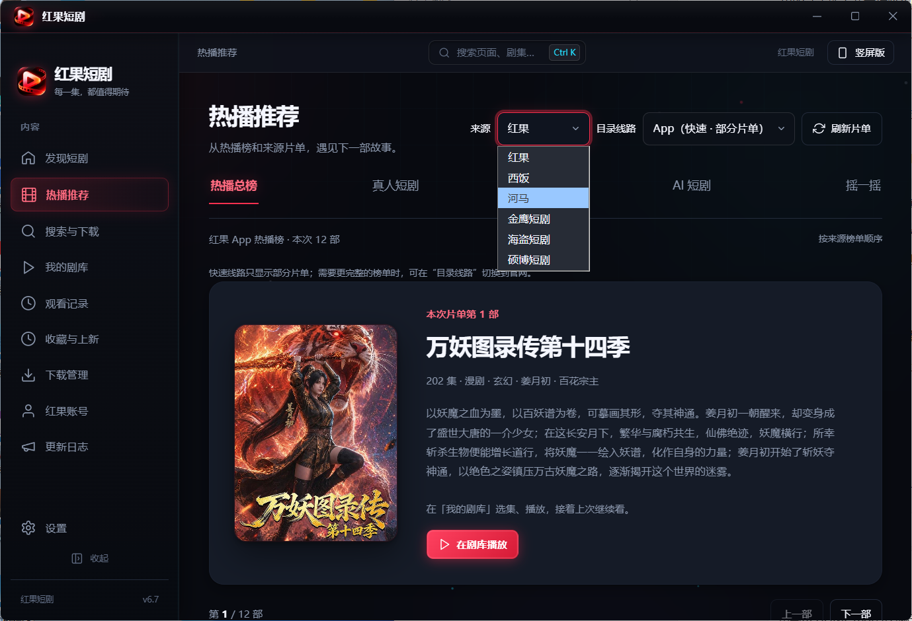
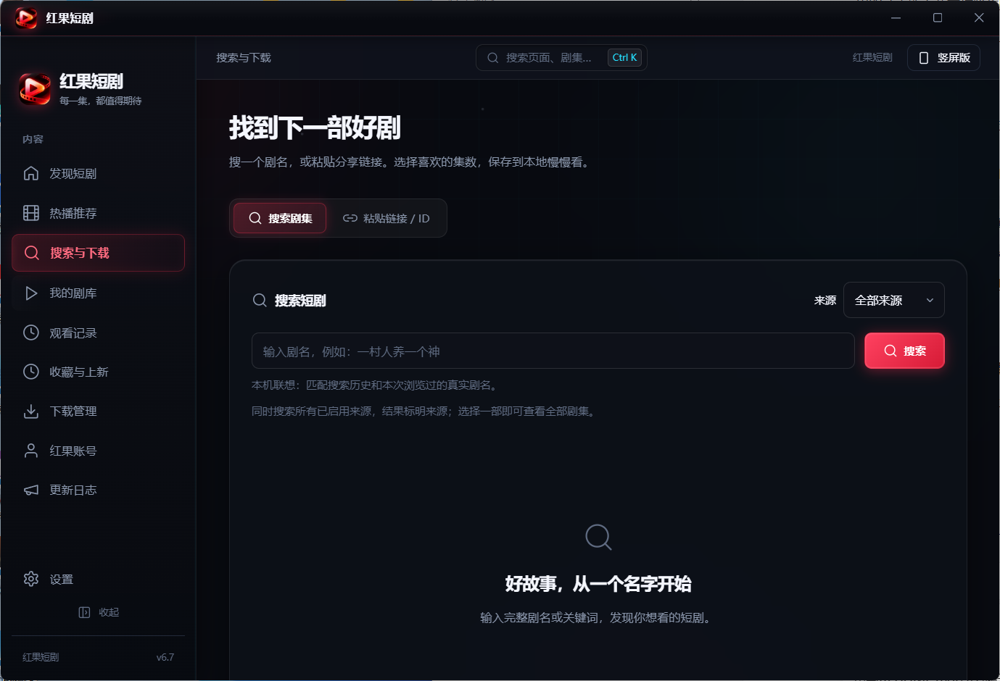
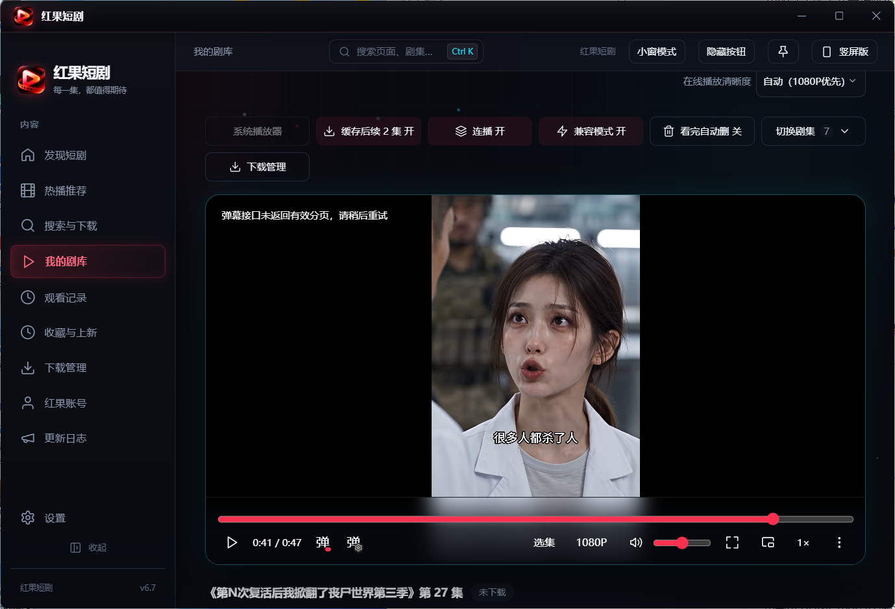
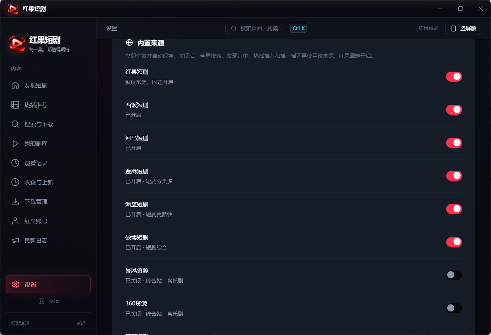

<div align="center">


# 红果短剧 · 桌面版

**挑一部喜欢的，让故事继续。**

搜剧、播放、下载、追更新、合并导出 —— 一个窗口里全部搞定。

[](https://github.com/yuchen0x1/HongGuo-PC/releases/latest)
[](#-下载)
[](LICENSE)
[](https://www.electronjs.org/)

[下载](#-下载) · [界面](#-界面) · [功能](#-功能) · [常见问题](#-常见问题) · [开发](#-开发) · [声明](#-声明)

</div>


---

## 📦 下载

当前正式版 **6.7**（内部 `6.7.0`，标签 `v6.7`），只发布 Windows x64。

| | |
|---|---|
| **下载地址** | [GitHub Releases 最新版](https://github.com/yuchen0x1/HongGuo-PC/releases/latest) |
| **文件** | `hongguo-downloader-6.7-win-x64-setup.exe` |
| **安装** | 双击运行，向导式安装，可自选安装目录 |

安装包**未做代码签名**。首次运行若弹出 SmartScreen 提示，点「更多信息 → 仍要运行」。

旧版本（6.0 – 6.6）的安装包保留在[历史发行页](https://github.com/yuchen0x1/HongGuo-PC/releases)。

> 发布页里还能看到一个 `latest.yml`，那是给旧版自动更新用的元数据，不是安装程序，不用管它。

---

## 🖼 界面

### 发现短剧


首页是找剧的主入口，一屏里同时给你四条线索：

- **来源 + 目录线路**：红果 / 西饭 / 河马 / 金鹰 / 海盗 / 硕博等来源随选随切；「App 快速线路」秒出部分片单，要完整目录切到「官网」
- **分类 × 题材**：真人剧、漫剧、AI 剧、漫画四大类，下面挂动作、逆袭、悬疑、古装等题材筛选项
- **榜单**：综合 / 真人 / 漫剧 / AI 四张热播榜，按来源自身热度排序，不打乱顺序
- **换一批**：沿当前来源和分类翻真实分页，不打乱榜单

海报墙随窗口宽度自动换行；放大窗口或全屏不会自动放大字号，界面始终按 100% 显示（需要时可在设置里手动缩放）。

### 热播推荐



换个角度找剧。左侧榜单、右侧大片卡，一页一部剧讲清楚：

- 热播总榜 / 真人短剧 / 漫剧 / AI 短剧四张榜单，外加「摇一摇」随机发现
- 每部剧显示集数、类型、题材和完整简介，不用点进去才知道讲什么
- 已经在剧库里的剧，直接「在剧库播放」，接着上次的进度看

### 搜索与下载



- **搜剧名**：一次搜索所有已启用的来源，结果标注来源，同名剧自动合并成一张卡片
- **贴链接 / ID**：手里有分享链接或剧集 ID 时直接粘进去
- **本机联想**：匹配搜索历史和本次浏览过的真实剧名，越用越顺手
- 选中一部剧就能看到全部剧集，逐集或批量下载

### 我的剧库



播放页把常用开关全摆在顶上，不用翻菜单：

- **播放**：双击画面进出全屏，空格短按暂停 / 长按临时 2 倍速；音量、静音、偏好倍速跨剧跨重启记忆
- **连播与缓存**：自动连播、可预缓存后续 2 集；切集保留上一集最后一帧直到新片源首帧上屏，不闪黑屏
- **画质**：自动优先 1080P，老电脑优先 H.264 片源、必要时提前转码；手动指定画质则保持固定不降级
- **兼容模式**：本机解不了 HEVC 时转码成 H.264，仍不行再试低一档片源
- **弹幕与选集**：弹幕开关、选集面板、画中画小窗、DLNA 投屏、系统播放器打开已下载本集

### 设置 · 内置来源



内置来源可随时开关，即时生效并自动保存：

| 来源 | 默认 | 说明 |
|---|---|---|
| 红果 | 固定开启 | 默认来源，不可关闭 |
| 西饭 / 河马 | 开启 | 短剧专站 |
| 金鹰 / 海盗 / 硕博 | 开启 | 短剧分类多、更新快 |
| 暴风 / 360 / 旺旺 | 关闭 | 综合站含长剧，按需打开 |

关闭一个来源后，全局搜索、发现片单、热播推荐和摇一摇都不再使用它。

---

## ✨ 功能

<details open>
<summary><b>找剧</b></summary>

- 聚合红果 / 西饭 / 河马 + 自建苹果 CMS 源，一次搜索全部来源
- 跨来源同名去重：多平台收录同一部剧时合并为一张卡片，标注「同剧 N 个来源」
- 发现页换批沿真实分页，热播榜保持来源热度顺序
- 同系列跨季切换：同来源、同剧名基名完全匹配才归组，在发现页与搜索页可直接切季
- 上新日历、摇一摇抽签、疑似新一季提示
- 搜索历史与本机联想

</details>

<details open>
<summary><b>下载</b></summary>

- 逐集或批量下载，任务队列 + 失败自动重试 + 重启后恢复任务状态
- 看完自动删除（直接下载到 NAS 的剧不参与）
- 下载到 NAS：视频、封面、简介、NFO 同层保存，规范分集命名，已有文件安全复用
- 下载管理支持选中任务批量停止、重试、删除，删除前确认
- 整剧合并导出，合并完成后清理临时分片

</details>

<details open>
<summary><b>播放</b></summary>

- 内置播放器：清晰度、倍速、弹幕字幕、快捷键、画中画、置顶
- 双击全屏、空格长按临时 2 倍速，键位可自定义
- 切集与自动连播保帧，消除黑屏 / 白屏闪烁
- 已完整下载的本集可用系统默认播放器打开
- DLNA 投屏到电视、单集评论

</details>

<details open>
<summary><b>追剧与整理</b></summary>

- 观看记录：逐条选择、全选当前列表、跨筛选保留选择、批量移除（只清记录，不删视频）
- 本机收藏、收藏与上新页追踪更新
- 「红果账号」页集中管理登录与 APP 观看记录

</details>

<details open>
<summary><b>桌面体验</b></summary>

- `Ctrl + K` 全局命令面板：搜页面、搜剧、搜历史
- 老板键：全局快捷键一键隐藏 / 恢复窗口
- 独立小窗模式、竖屏 / 横屏布局切换
- 设置页支持分类锚点导航与关键词搜索

</details>

<details>
<summary><b>更新</b></summary>

- 启动时及运行期间每 6 小时检查一次正式版
- 发现新版本只提醒并打开 GitHub 下载页，不在应用内下载或安装

</details>

---

## ❓ 常见问题

<details>
<summary><b>提示「此来源已关闭」怎么办？</b></summary>

去 **设置 → 内置来源** 把对应来源打开即可。红果固定开启，其余八个随时可切换。
</details>

<details>
<summary><b>搜索结果里的「同剧 N 个来源」是什么？</b></summary>

同一部剧被多个站点收录时自动合并成一张卡片，避免重复占屏。选中后默认使用首选来源，其余来源标在徽标里。
</details>

<details>
<summary><b>怎么升级到新版本？</b></summary>

应用会在发现新版本时提醒并打开 GitHub 下载页。下载新的安装程序直接运行即可，设置、观看记录和下载任务都会保留。
</details>

<details>
<summary><b>下载到 NAS 有什么不同？</b></summary>

直接写进你已挂载的目录，视频、封面、简介与 NFO 同层保存，分集按规范命名，已存在的文件不会被覆盖。这个模式下「看完自动删除」不生效。
</details>

<details>
<summary><b>支持 macOS 吗？</b></summary>

自 6.2 起仅发布和维护 Windows x64，macOS 不在发行范围内。仓库里保留了本地构建脚本，但不对其提供发行承诺。
</details>

---

## 🛠 开发

需要 **Node.js ≥ 22.12**。

```bash
git clone https://github.com/yuchen0x1/HongGuo-PC.git
cd HongGuo-PC
npm install                   # 安装依赖
npm run dev                   # 开发模式（Vite + Electron 热重载）
npm test                      # 单元测试与平台检查
node scripts/setup-ffmpeg.js  # 准备 Windows FFmpeg 二进制（打包前必须，不入库）
npm run build:installer       # 构建 Windows x64 NSIS 安装程序
```

<details>
<summary><b>项目结构</b></summary>

```
├── main.js               # Electron 主进程（窗口、IPC、下载、更新）
├── preload.js            # 渲染层安全桥接
├── src/
│   ├── components/       # React 界面组件
│   ├── native/           # 主进程模块（来源适配、HLS、下载、播放）
│   └── store.js          # 本机持久化
├── scripts/              # 构建与回归检查
├── docs/screenshots/     # 界面截图
└── build/                # 打包资源（图标、FFmpeg 许可证）
```

</details>

<details>
<summary><b>发版记录</b></summary>

每个版本的变更、验证范围与已知限制见 `docs/release-*.md`，当前版本见 [release-6.7.md](docs/release-6.7.md)。

</details>

---

## ⚖️ 声明

- 本仓库是 [jackotom/hongguo-drama](https://github.com/jackotom/hongguo-drama)（GPL-3.0）的社区二次开发版，**不是红果 / 西饭 / 河马的官方客户端**，未获平台背书，不提供付费分集解锁。
- 延续上游 **[GPL-3.0](LICENSE)** 许可并保留修改与来源声明；上游与算法致谢见 [NOTICE](NOTICE)，第三方组件许可见 [THIRD-PARTY-NOTICES.md](THIRD-PARTY-NOTICES.md)。
- 开源许可只适用于软件本身，不授予剧集内容的再分发权。安装包不含任何剧集媒体；作品版权归原平台及创作者所有。请仅处理你有权访问、下载或备份的内容，遵守平台条款与相关法律。

---

<div align="center">

如果这个项目对你有帮助，点个 ⭐ 就是最好的支持

</div>